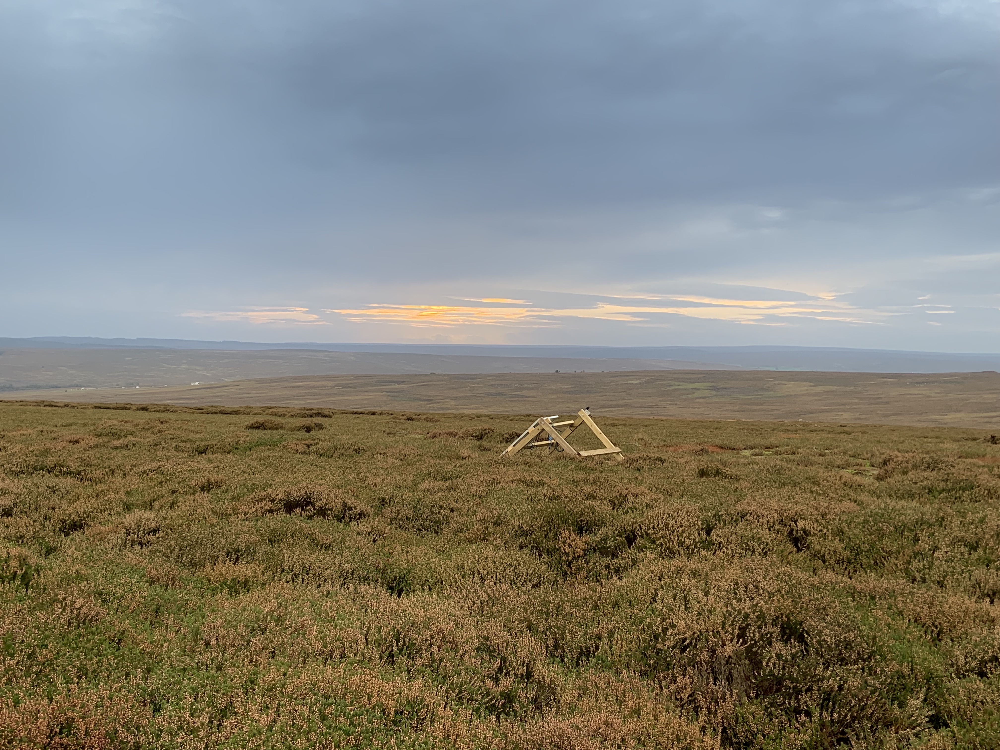

# About

I'm a quantitative researcher with a background in seismology and an interest in commodity markets, futures and systematic trading.

Prior to entering the world of quantiative finance, I was a research seismologist at the University of Oxford and University of Bristol. I used seismology to study dynamic Earth processes at a range of scales, from the Earth's crust down the the core-mantle boundary.  

At the University of Oxford, worked as part of the [Oxford Martin School AGILE Initiative project](https://www.agile-initiative.ox.ac.uk/sprints/what-do-we-need-to-knre-co2-beneath-our-shelf-seas/). AGILE is an  ambitious initiative, to develop a model for research based on policy pulls. Our project focused on offshore CO2 storage. I worked to test the hypothesis that seismic arrays (a group of seismometers deployed to allow signal stacking) deployed onshore can detect micro-earthquakes ~200km offshore. This technology would allow for cost-effective monitoring of offshore CO2 storage sites. As part of this project, colleagues and I installed and maintained an eight element seismic array in North Yorkshire.

<!--  -->

I also contributed to the EU ACT project [SHARP](https://www.sharp-storage-act.eu/work-package-2-seismicity/) where we are seeking to use signals from micro-earthquakes to obtain stress orientation and magnitude in near surface rocks passively (i.e., without having to stress them out further by drilling).

I am now collaborating with Dr Paula Koelemeijer on a project to detect microseimicity beneath London, and am continuing to work on onshore monitoring of offshore microseismicty and linking seismic anisotorpy to the subsurface stress field.

[Click here](/academic_cv) to see my CV, and [here](/assets/files/J_Asplet_CV.pdf) to download a print version, last updated December 2024.

If you have come here from EGU 2025, a PDF copy of my poster "Gone APE: Spatiotemporal variations in shear-wave splitting
during the 2018-19 Surrey, UK, earthquake sequence" can be found [here](/files/assets/Asplet_EGU2025_Poster_Gone_APE/pdf) and the references can be found [here](/posts/2025-04-15-egu-poster-references.md).

If you cannot find me in the office, you'll probably find me in one of Oxford's many Cafés, Cricket Grounds or in the gym. I currently play for [Oxford and Bletchingdon Nondescripts CC](https://obncc.play-cricket.com/home) and [Isis CC](http://www.isiscc.org.uk/).

Outside of work I am currently learning French, and am trying to manage my growing [Warhammer Collection](_posts/2023-09-23-warhammer_gallery.md).

<!-- By default, the theme only contains these few pages in order to stay lean and flexible. However, it can be easily extended to accommodate more pages, [collections](https://jekyllrb.com/docs/collections/), [categories, and tags](https://jekyllrb.com/docs/posts/#tags-and-categories). -->

<!--  -->
